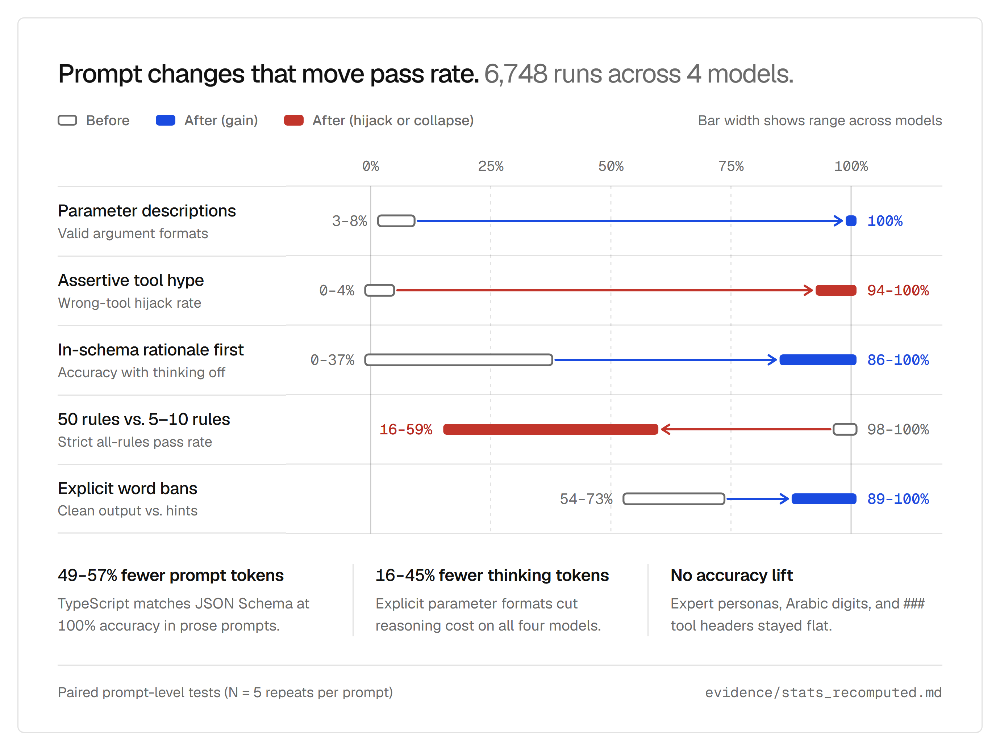

<h1 align="center">agent-system-authoring</h1>

<p align="center">
  <strong>Evidence-backed rules for writing LLM system prompts, tool schemas, and portable Agent Skills.</strong>
</p>

<p align="center">
  <a href="https://github.com/floydous/agent-system-authoring/actions/workflows/verify.yml"></a>
  <a href="https://agentskills.io/specification"></a>
  <a href="skills/agent-system-authoring/SKILL.md"></a>
  <a href="LICENSE"></a>
</p>

<p align="center">
  <a href="#quickstart">Quickstart</a> ·
  <a href="#whats-included">What's Included</a> ·
  <a href="#what-held-up">What Held Up</a> ·
  <a href="#verify-locally">Verify Locally</a> ·
  <a href="evidence/README.md">Evidence Archive</a>
</p>

<table align="center">
  <tr>
    <td align="center" width="190"><h3>8,028</h3><b>Benchmark calls</b><br><sub>7,800 at N=5 + 228 Phase A</sub></td>
    <td align="center" width="190"><h3>28</h3><b>Tagged rules</b><br><sub>every rule tagged with its evidence tier</sub></td>
    <td align="center" width="190"><h3>3</h3><b>API providers</b><br><sub>OpenAI, Anthropic, Gemini</sub></td>
    <td align="center" width="190"><h3>119.3 KB</h3><b>Skill install</b><br><sub>56-line SKILL.md, 11 files</sub></td>
  </tr>
</table>

---

## Quickstart

Install the skill with [vercel-labs/skills](https://github.com/vercel-labs/skills) (`Node.js >= 22.20`):

```bash
npx skills add floydous/agent-system-authoring
```

Only `skills/agent-system-authoring/` gets installed into your project. Raw benchmark logs, provenance harnesses, and unit tests stay out of your workspace.

<details>
<summary><strong>More install options (preview, global, pinned version)</strong></summary>

```bash
# Inspect discovered skills before installing
npx skills add floydous/agent-system-authoring --list

# Install globally across projects
npx skills add floydous/agent-system-authoring -g

# Pin to the v2.1.0 release tag
npx skills add floydous/agent-system-authoring@v2.1.0
```

</details>

## Why this exists

Most prompting advice circulates as folklore. A trick from an older model gets copied into production prompts, and nobody checks whether it still helps or just burns tokens.

This skill gives coding agents a short, tested playbook for authoring system prompts, tool schemas, and portable Agent Skills. Every rule states how we know it works: checked directly against provider API docs, measured across repeated model runs, or labeled clearly as vendor guidance or an open question.

## What's included

<table width="100%">
  <tr>
    <td width="50%" valign="top">
      <h4><a href="skills/agent-system-authoring/references/system_instructions_guide.md">System prompts</a></h4>
      <p>Instruction hierarchy, keeping active rule counts small, explicit word bans, clean delimiters, and skipping filler personas.</p>
      <br/>
    </td>
    <td width="50%" valign="top">
      <h4><a href="skills/agent-system-authoring/references/tool_schema_guide.md">Multi-provider tool schemas</a></h4>
      <p>Exact strict-mode JSON shapes for OpenAI, Anthropic, and Gemini, neutral tool descriptions, and parameter format rules.</p>
      <br/>
    </td>
  </tr>
  <tr>
    <td width="50%" valign="top">
      <h4><a href="skills/agent-system-authoring/references/skill_design_guide.md">Portable Agent Skills</a></h4>
      <p>Spec-compliant <code>SKILL.md</code> structure, progressive disclosure, one-hop references, PEP 723 scripts, and a standalone linter.</p>
      <br/>
    </td>
    <td width="50%" valign="top">
      <h4><a href="evidence/evidence_ledger.md">Evidence and templates</a></h4>
      <p>All 28 rules with verification tiers, a list of refuted myths, open hypotheses, and ready-to-edit starter templates.</p>
      <br/>
    </td>
  </tr>
</table>

*Starter files:* [SKILL.md](skills/agent-system-authoring/SKILL.md) · [System Prompt Template](skills/agent-system-authoring/assets/templates/system_prompt_template.md) · [Tool Schema Template](skills/agent-system-authoring/assets/templates/tool_schema_template.json) · [Zero-Reasoning Tool Template](skills/agent-system-authoring/assets/templates/tool_schema_zero_reasoning_template.json) · [Debunked Folklore](skills/agent-system-authoring/references/debunked_folklore.md)

## What held up

We ran 8,028 benchmark calls across four model families, plus 490 skill-eval calls and 85 isolated coding-agent sessions. Repeated runs (N = 5 per prompt) are averaged at the prompt level before statistical testing.

<p align="center">
  <picture>
    <source media="(prefers-color-scheme: dark)" srcset="evidence/charts/what_held_up_dark.png">
    <source media="(prefers-color-scheme: light)" srcset="evidence/charts/what_held_up_light.png">
    
  </picture>
</p>

**Key takeaways:**
- **Be explicit on formats and bans:** specify exact parameter syntax and units, and name forbidden words directly instead of relying on hints.
- **Keep prompts and tool sets lean:** prune large tool catalogs, keep concurrent rule counts small, and keep tool descriptions factual and neutral.
- **Match the model mode:** put a `rationale` field first only when pre-output thinking is off, and skip CoT prompts, honorary personas, and `###` tool headers.
- **Use TypeScript in prose prompts:** it matched JSON Schema accuracy at half the prompt tokens (keep JSON Schema for native tool APIs).

### Skill evaluation

Tested on `GPT 6 Luna` against the current 119.3 KB skill package ([evals_results.md](evidence/evals_results.md), [stats_recomputed.md](evidence/stats_recomputed.md)):

| Evaluation | Baseline | With skill | Result |
| :--- | :--- | :--- | :--- |
| **Skill triggering** (9-skill registry + solo stress) | - | 1.000 F1, 50/50 solo | Zero false triggers across 210 calls |
| **Objective authoring probes** (8 tasks x 5) | 29/40 (72.5%) | **40/40 (100%)** | Clean wire shapes, tool routing, and math |
| **Dual-order blinded judge** (10 tasks x 5 pairs) | 0.812 | **0.874** | Won 10/10 tasks (p = 0.0002) |
| **Coding agent: multi-provider tool repair** | 40% (0/5 strict) | **86%** (2/5 strict) | +46pp (p = 0.0079), 12% faster |
| **Coding agent: broken skill repair** | 66% (0/5 strict) | **98%** (4/5 strict) | +32pp (p = 0.0079), 10% faster |
| **Coding agent: prompt hardening refactor** | 88% (0/5 strict) | **92%** (2/5 strict) | +4pp (n.s., p = 0.63); 2/5 strict runs read guide |

> [!NOTE]
> Live benchmarks cover four gateway model families (`GPT 6 Luna`, `Particle-1`, `Nemotron 3.5 Lightning`, and `Ling 3.2 Flash`; exact slugs and provenance in [source_checks.md](evidence/source_checks.md)). Closed frontier models (`Claude Opus 5.5`, `Claude Fable 5.2`, `Gemini 4 Hydrogen`, `GPT 6.2 Astra`) remain open in [unverified_hypotheses.md](evidence/unverified_hypotheses.md).

<details>
<summary><strong>Evaluation methodology, caveats, and trade-offs</strong></summary>

- **Benchmark call breakdown**: 8,028 calls total = 7,800 calls across Phases B to G and `H-08` (N = 5 repeats across 6 to 16 prompts per suite) plus 228 exploratory N = 1 calls in Phase A.
- **Benchmark caveats**: Parameter descriptions cut reasoning tokens on all 4 models while raising prompt tokens (+30% to +73%) and total tokens on 3 of 4 models. Explicit word bans were tested against unstated affirmative hints (`paired` vs `bare` lexical exclusion p >= 0.33). Phase splitting is derived from `PE-1` rule-density degradation rather than ablated directly as a separate arm. TypeScript vs JSON Schema parity is a 100% ceiling across 3 families; personas and `###` tool headers were measured on 1 model.
- **Eval Suite v4 details (2026-11-28)**: 48/50 clean `'none'` on overlapping negatives; objective probe task-level test p = 0.1295 (`comp_05` and `comp_08` moved 0/5 -> 5/5; hardened `comp_07` `8325c`/`18d` scored 5/5); dual-order blinded judge swap-consistent pairs 20 skill / 2 baseline / 28 flip-or-tie (t(9) = 5.92, p = 0.0002; same-family `GPT 6 Luna` judge caveat).
- **Pi coding-agent details (85 sessions total)**: Isolated headless `pi v1.6.0` runs on P = 1 fixed broken repository fixture per task (N = 5 runs per arm; tests stochastic variance on that fixture rather than cross-repo generalization). Earlier iterations (55 sessions) validated initial gains (`42% -> 78%`, `58% -> 76%`), a Step-3 fix (`0/5 -> 5/5` strict), and post-slim trimming (`68%` / `96%` / `90%` with 0/15 reference reads). The latest 30-session paired A/B run on the 119.3 KB package lifted matched reference-guide reads to 10/15 and strict 10/10 passes from 0/15 to 8/15, with higher token usage from reading reference guides (`100k -> 136k`, `145k -> 185k`, `48k -> 112k`).

</details>

<details>
<summary><strong>Evidence tiers (T1 to T5)</strong></summary>

Every rule in [evidence_ledger.md](evidence/evidence_ledger.md) carries one primary verification tag:

| Tier | Meaning |
| :--- | :--- |
| **T1** | Specification or provider API rule checked directly against official docs ([source_checks.md](evidence/source_checks.md)). |
| **T2** | Statistically significant prompt-level effect recomputed offline from bundled traces ([stats_recomputed.md](evidence/stats_recomputed.md)). |
| **T3** | Current official vendor guidance (Anthropic, OpenAI, Google), not measured by our harness. |
| **T4** | Peer-reviewed finding rooted in fixed mechanics (BPE tokenization, constrained decoding, context cost, FP non-determinism). |
| **T5** | Peer-reviewed learned behavior from earlier models; transfer to newer models is plausible but not re-measured. |
| **Methodology / Convention** | Evaluation design principles (`R-SYS-10`) or repo engineering standards (`R-SKILL-05`). |

</details>

<details>
<summary><strong>Full benchmark archive (8,028 benchmark calls + 490 eval calls + 85 real-agent Pi sessions)</strong></summary>

| Suite | Model | Calls | Focus | Full report |
| :--- | :--- | :---: | :--- | :--- |
| **Phase A** | `GPT 6 Luna` | 228 | Initial screening (N = 1) across 7 prompt and schema suites | [stats_recomputed.md](evidence/stats_recomputed.md) |
| **Phase B** | `GPT 6 Luna` | 480 | Equalized delimiters, personas, `rationale` ordering (N = 5) | [stats_recomputed.md](evidence/stats_recomputed.md) |
| **Phase C** | `GPT 6 Luna` | 480 | Counterbalanced tool gaming (`PC-1`) and explicit bans (`PC-2`) | [stats_recomputed.md](evidence/stats_recomputed.md) |
| **Phase D** | `GPT 6 Luna` | 1,030 | Param descriptions, verbosity ceiling, headers, digits, TS vs JSON | [stats_recomputed.md](evidence/stats_recomputed.md) |
| **Phase E** | `GPT 6 Luna` (`high`) | 880 | Rule density (5 to 50), long-context reminders, hard math personas | [stats_recomputed.md](evidence/stats_recomputed.md) |
| **`H-08` Replication** | `Particle-1` | 950 | Cross-model replication of `PC-1`, `PC-2`, `PD-1`, `PD-4`, `PD-5` | [stats_recomputed.md](evidence/stats_recomputed.md) |
| **Phase F Cross-Arch (Nemotron)** | `Nemotron 3.5 Lightning` | 1,190 | Cross-family replication of `PB-6`, `PC-1`, `PC-2`, `PD-1`, `PD-4`, `PE-2` | [stats_recomputed.md](evidence/stats_recomputed.md) |
| **Phase F Cross-Arch (Ling)** | `Ling 3.2 Flash` | 1,510 | Cross-family replication of `PB-6`, `PE-1`, `PC-1`, `PC-2`, `PD-1`, `PD-4`, `PD-5` | [stats_recomputed.md](evidence/stats_recomputed.md) |
| **Phase G Stress & Untouched Rules** | `GPT 6 Luna` | 1,280 | Tool catalog scaling (`PG-1`), CoT on reasoning (`PG-2`), conflicting few-shots (`PG-3`), 16-turn memory (`PG-4`), 67k context (`PG-5`) | [stats_recomputed.md](evidence/stats_recomputed.md) |
| **Eval Suite v4** | `GPT 6 Luna` | 490 | 9-skill triggering, solo precision, objective probes, dual-order judge (2026-11-28) | [evals_results.md](evidence/evals_results.md) |
| **Pi Real-Agent Evals** | `GPT 6 Luna` (`pi v1.6.0`) | 85 sessions | Multi-turn broken-repo repair (N = 5 x 3 repos, P = 1/task), Step-3 A/B fix, post-slim & Phase 5 A/B | [stats_recomputed.md](evidence/stats_recomputed.md) |

All 7,800 Phase B to G and `H-08` runs, all 490 Eval v4 runs, and all 85 real-agent Pi sessions completed with 0 errors. Narrative synthesis lives in [empirical_results.md](evidence/empirical_results.md).

</details>

## Verify locally

All packaging checks, unit tests, and statistical tables run offline using Python's standard library alone (no API keys or extra packages needed). `recompute_stats.py` and `run_evals.py --rescore-only` verify report aggregation and stored-trace invariants, while `unittest` re-evaluates raw Phase B to G and `H-08` responses against the harness evaluators:

```bash
python -B skills/agent-system-authoring/scripts/verify_skill.py skills/agent-system-authoring
python -B skills/agent-system-authoring/scripts/verify_skill.py --generic skills/agent-system-authoring
python -B evidence/recompute_stats.py --check
python -B evidence/run_evals.py --rescore-only --check
python -B -m unittest discover -s tests -v
```

These same checks run automatically on Ubuntu and Windows in [.github/workflows/verify.yml](.github/workflows/verify.yml). Pass `--generic` to `verify_skill.py` to lint any external Agent Skill folder.

## Repository layout

| Path | Contents |
| :--- | :--- |
| [`skills/agent-system-authoring/`](skills/agent-system-authoring/SKILL.md) | Installable skill package: `SKILL.md`, authoring guides, starter templates, eval suite, and stdlib linter. |
| [`evidence/`](evidence/README.md) | Raw JSONL completion traces, provenance harnesses, primary-source check log, and offline stats scripts. |
| [`tests/`](tests/) | Standard-library unit tests covering `verify_skill.py` and evidence utilities. |
| [`.github/workflows/verify.yml`](.github/workflows/verify.yml) | Cross-OS GitHub Actions workflow enforcing skill conformance and stats reproducibility. |

## License

Released under the [MIT License](LICENSE).
